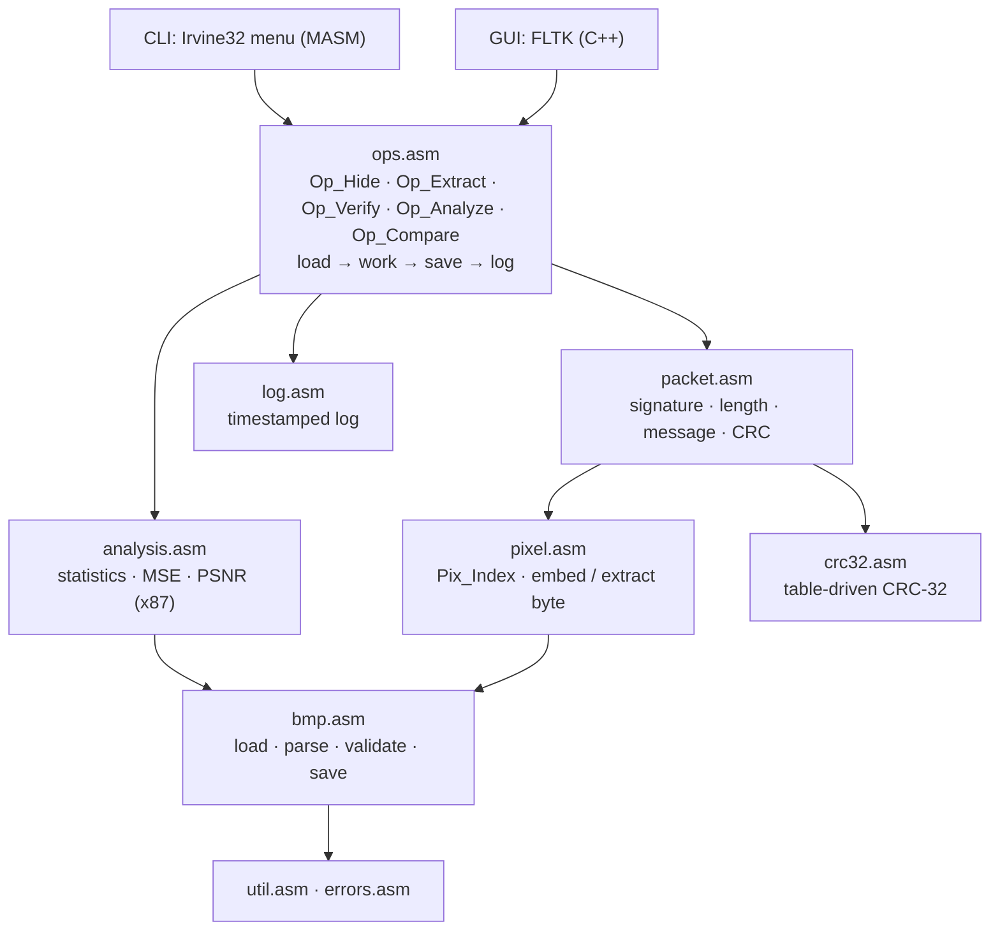

<div align="center">

# 🕵️ ASM Stego Lab

**An image steganography and analysis utility written in x86 Assembly (MASM + Irvine32), with a console menu and an FLTK GUI over one shared engine.**

[](https://learn.microsoft.com/en-us/cpp/assembler/masm/microsoft-macro-assembler-reference)
[](https://github.com/surferkip/asmbook)
[-2E8B57)](https://www.fltk.org/)
[](https://visualstudio.microsoft.com/)
[](#testing)

[Features](#features) · [Architecture](#architecture) · [Getting Started](#getting-started) · [Report an Issue](../../issues)

</div>

---

## Overview

ASM Stego Lab hides a text message (up to 4096 characters) inside a **24-bit uncompressed BMP** by replacing the least significant bit of its colour bytes, and recovers it later. Each byte changes by at most 1 out of 255, so the encoded image looks identical to the original. The hidden data is stored as a packet with a signature, a length and a **CRC-32**, so the program can report a message as `VALID` or `CORRUPTED`.

Beyond hiding and extracting, it analyses a single image, compares an original against an encoded copy (changed bytes and bits, **MSE and PSNR computed with the x87 FPU**) and records every action in a timestamped log that can be viewed, cleared or backed up.

**All application logic is written in MASM.** The Irvine32 console menu and the FLTK GUI are two thin front ends over the same `Op_*` procedures, so they behave identically and every action is logged exactly once. The GUI contains no image logic at all.

It was built as the semester project for **EL-2003 Computer Organization and Assembly Language (COAL) Lab** at FAST NUCES Karachi, to see how data can be hidden in an image at the level of individual bytes and bits.

## Table of Contents

- [Features](#features)
- [Tech Stack](#tech-stack)
- [How It Works](#how-it-works)
- [Architecture](#architecture)
- [Engine API Reference](#engine-api-reference)
- [Project Structure](#project-structure)
- [Getting Started](#getting-started)
- [Usage](#usage)
- [Testing](#testing)
- [Demo](#demo)
- [Design Notes](#design-notes)
- [Limitations](#limitations)
- [Roadmap](#roadmap)
- [Team](#team)
- [License](#license)

## Features

- **Hide Message**: LSB-embeds text into a cover BMP with a capacity check and saves a *new* encoded image (the cover is never overwritten, `ERR_SAME_FILE`).
- **Extract Message**: finds the `STG1` signature, reads the length and rebuilds the hidden text.
- **Verify Integrity**: recomputes a table-driven CRC-32 and reports **VALID** or **CORRUPTED**, showing stored and calculated values.
- **Analyze Image**: width, height, file size, row stride, pixel count, capacity, B/G/R averages, LSB statistics and hidden-message detection.
- **Compare Images**: changed bytes and bits, largest difference, 64-bit sum of squares, MSE and PSNR; identical images are detected and reported.
- **Handle Report**: timestamped log of every action; view, clear, or back up (copy, then start a fresh log).
- **Robust BMP validation**: signature, bit depth, compression, dimensions, data offset and size, with overflow checks; supports row padding and top-down (negative height) BMPs.
- **Two front ends, one engine**: Irvine32 console menu and an FLTK GUI with one tab per operation.
- **Built-in self-test**: 89 automatic checks, runnable from the command line with the exit code equal to the number of failures.

## Tech Stack

| Layer | Technology |
|---|---|
| Language | x86 Assembly (MASM, 32-bit) |
| Library | Irvine32 (console I/O, file I/O, string helpers) |
| Floating point | x87 FPU (`FILD`, `FIDIV`, `FYL2X`, `FLDLG2`, …) |
| GUI | C++ with FLTK (via vcpkg) |
| Windows API | `GetLocalTime`, `ExitProcess` only |
| Build | Visual Studio 2026 (`StegoLab.slnx`, 3 projects) |
| Tooling | Python 3 (test image generator and test runner) |

## How It Works

### LSB embedding

One hidden **byte** is spread over **8 consecutive colour bytes**, most significant bit first, one bit per colour byte:

```
hidden byte  =   1    0    1    1    0    0    1    0
                 │    │    │    │    │    │    │    │
colour bytes = [..1][..0][..1][..1][..0][..0][..1][..0]    only bit 0 of each changes
```

```asm
mov    dl, [edi]        ; the colour byte
and    dl, 0FEh         ; clear its lowest bit
or     dl, al           ; put the secret bit there
mov    [edi], dl
```

### Hidden packet format

```
┌────────────┬─────────────┬────────────────┬─────────────┐
│  "STG1"    │ length (LE) │ message bytes  │ CRC-32 (LE) │
│  4 bytes   │   4 bytes   │    L bytes     │   4 bytes   │
└────────────┴─────────────┴────────────────┴─────────────┘
         12 bytes overhead  →  capacity = colour bytes / 8 − 12
```

A 64×48 image has 9 216 colour bytes, which gives 1 152 − 12 = **1 140 message bytes**.

### Skipping row padding

BMP rows are padded to a multiple of 4 bytes. Only `Pix_Index` knows this; every other module asks it for "colour byte number *n*":

```
row    = n ÷ rowBytes
col    = n mod rowBytes
offset = dataOffset + row × rowStride + col
```

### Expected image quality

Each changed colour byte differs by exactly 1, so **MSE ≤ 1 and PSNR ≥ 48 dB** for any image (about 65 dB for a short message on a 64×48 image).

## Architecture



Three layers: **front ends** (input and output only), the **application layer** (`ops.asm`: load → work → save → log) and the **engine modules**, each doing one job and testable alone.

## Engine API Reference

Every procedure is **STDCALL** (C++ sees it as `_Name@N`) and returns an error code in `EAX` (`0` = success). Engine procedures never print.

**Operations** (each also writes one log line)

| Procedure | Description | Errors |
|---|---|---|
| `Op_Hide` | Load cover, hide message, save encoded image | `ERR_SAME_FILE` · `ERR_MSG_TOO_BIG` · `ERR_EMPTY_MSG` · load/save errors |
| `Op_Extract` | Load image, read the hidden message | `ERR_NO_SIG` · `ERR_BAD_LENGTH` · `ERR_BUF_SMALL` |
| `Op_Verify` | Load image, check CRC-32 | `ERR_CRC_BAD` (CORRUPTED) · `ERR_NO_SIG` |
| `Op_Analyze` | Load image, fill `ANALYSISINFO` | load errors |
| `Op_Compare` | Load two images, fill `COMPAREINFO` | `ERR_SIZE_MISMATCH` |

**Log** (`Handle Report`)

| Procedure | Description |
|---|---|
| `Log_Read` | Copy the whole log to the caller's buffer |
| `Log_Clear` | Empty the log |
| `Log_Backup` | Copy the log to a backup file (auto-named if empty), then start a new one |

**Core modules**

| Module | Key procedures |
|---|---|
| `bmp.asm` | `Bmp_Load` · `Bmp_Parse` · `Bmp_Check` · `Bmp_Save` |
| `pixel.asm` | `Pix_Index` · `Pix_EmbedByte` · `Pix_ExtractByte` |
| `packet.asm` | `Pkt_Capacity` · `Pkt_Hide` · `Pkt_Extract` · `Pkt_Verify` · `Pkt_ReadHeader` |
| `crc32.asm` | `Crc_Init` · `Crc_UpdateByte` · `Crc_Compute` |
| `analysis.asm` | `An_Analyze` · `An_Compare` |
| `errors.asm` | `Stego_ErrorText` (same wording in CLI and GUI) |

**Error codes**

| Code | Name | Meaning |
|---|---|---|
| 0 | `ERR_OK` | Success |
| 1 | `ERR_FILE_OPEN` | Could not open the file |
| 2 | `ERR_NOT_BMP` | Missing `BM` signature |
| 3 | `ERR_NOT_24BIT` | Only 24-bit images supported |
| 4 | `ERR_COMPRESSED` | Compressed BMP not supported |
| 5 | `ERR_BAD_SIZE` | Invalid or truncated BMP |
| 6 | `ERR_TOO_BIG` | File larger than 8 MB |
| 7 | `ERR_MSG_TOO_BIG` | Message exceeds image capacity |
| 8 | `ERR_NO_SIG` | No hidden message found |
| 9 | `ERR_BAD_LENGTH` | Hidden length is invalid |
| 10 | `ERR_CRC_BAD` | CRC mismatch, **CORRUPTED** |
| 11–16 | `ERR_FILE_WRITE` … `ERR_BUF_SMALL` | Write/read failure, bad slot, no image, empty message, small buffer |
| 17 | `ERR_SIZE_MISMATCH` | Compared images differ in size |
| 18–19 | `ERR_LOG_EMPTY` · `ERR_LOG_FULL` | Log empty or over 64 KB |
| 20 | `ERR_SAME_FILE` | Output would overwrite the cover |

## Project Structure

```
StegoLab/
├── engine/                # Shared MASM logic layer (static library)
│   ├── stego.inc          # Error codes, limits, structures, prototypes
│   ├── bmp.asm            # Load, parse, validate, save BMP
│   ├── pixel.asm          # Pix_Index, embed / extract byte
│   ├── packet.asm         # Hidden packet: hide, extract, verify, capacity
│   ├── crc32.asm          # Table-driven CRC-32
│   ├── analysis.asm       # An_Analyze, An_Compare (MSE / PSNR, x87)
│   ├── log.asm            # Timestamped log, clear, backup
│   ├── ops.asm            # The five user operations + logging
│   ├── errors.asm         # Error texts shared by CLI and GUI
│   ├── util.asm           # LE readers, MemCopy/MemZero, StrCat, …
│   └── smoke.asm          # Step-0 smoke test (kept for reference)
├── cli/                   # Irvine32 console front end
│   ├── main.asm           # Menu loop and --selftest switch
│   ├── ui.asm             # One screen per operation
│   └── selftest.asm       # 89 automatic checks
├── gui/                   # FLTK front end (C++)
│   ├── main.cpp           # Window and tabs
│   ├── panels.cpp / .h    # One tab per operation
│   └── stego_api.h        # C++ view of the MASM engine
├── StegoEngine/           # VS project: static library
├── StegoCLI/              # VS project: console app
├── tests/                 # Valid and deliberately broken sample BMPs
├── tools/
│   ├── make_test_bmps.py  # Generates the test images + Python reference check
│   ├── run_tests.py       # One-command automatic test
│   └── pack_for_sharing.py
├── docs/PROJECT_GUIDE.md
├── StegoLab.slnx          # Visual Studio solution
├── StegoLab.vcxproj       # StegoGUI project
└── vcpkg.json             # FLTK dependency
```

## Getting Started

### Prerequisites

- Windows with **Visual Studio 2026** (MASM and Desktop C++ workloads)
- The **Irvine32** library installed at `C:\Irvine`
- Python 3 (only for the test tools)

FLTK is restored automatically through vcpkg (`vcpkg.json`).

### Installation

```bash
# 1. Clone the repository
git clone https://github.com/Usaim-Khan/SteganographyLab-ASM.git
cd SteganographyLab-ASM

# 2. Open the solution in Visual Studio
start StegoLab.slnx
```

3. Set the configuration to **Debug / x86**.
4. Build **StegoEngine** first, then **StegoCLI** and **StegoGUI**.

> Run the CLI and GUI from the **same working folder** so both write to the same `stego_log.txt`.

## Usage

### Console

```
=== ASM Stego Lab - Image Steganography and Analysis ===
 1. Hide Message
 2. Extract Message
 3. Analyze Image
 4. Verify Integrity
 5. Compare Images
 6. Handle Report (log file)
 0. Exit
```

Paths may be pasted with quotes (Windows *Copy as path* works).

### GUI

Run `StegoGUI.exe`. One tab per operation, native file dialogs, and a coloured **VALID / CORRUPTED** badge on the Verify tab.

### Sending an encoded image

Share it as a **file or document**, never as a photo. Messaging apps recompress photos and destroy the hidden bits.

### Log format

```
[2026-11-18 14:03:22] HIDE OK | cover.bmp -> out.bmp
[2026-11-18 14:04:05] EXTRACT FAILED: Not a BMP file (missing 'BM' signature). | photo.png
```

## Testing

The self-test runs inside the assembly program itself and returns the number of failed checks as its exit code.

```bash
python tools\run_tests.py
# or directly
StegoCLI.exe --selftest tests
```

| Part | Covers | Checks |
|---|---|---|
| A | `Bmp_Load` error codes on 15 test files | 15 |
| B | `Pix_Index` row-padding arithmetic | 14 |
| C | CRC-32 known value (`"123456789"` → `0CBF43926h`) | 2 |
| D | Hide / extract / verify, tampering, capacity limits | 21 |
| E | Same round trip on an image with padded rows | 6 |
| F | `Op_*` operations, Analyze, Compare (MSE / PSNR) | 25 |
| G | Log write, read, backup, timestamp | 6 |
| | **Total** | **89** |

Test images come from `tools/make_test_bmps.py`, which also cross-checks them against a Python reference of the parser, so the whole set can be rebuilt at any time.

## Demo

A 5-minute walkthrough covers the code base, CLI hide and extract on two laptops, the self-test, and the GUI (analyze, hide, backup and clear log, compare, failure cases). See `docs/` for the flow.

## Design Notes

A few deliberate choices worth calling out:

- **Engine never prints.** Procedures return an error code in `EAX` and fill result structures, so the CLI and GUI share them untouched.
- **One place for padding.** Only `Pix_Index` knows about row padding, which keeps hide, extract and compare consistent and easy to test.
- **No C++ file fallback.** The proposal allowed one, but a Step-0 smoke test (`Stego_SmokeTest`) proved Irvine32 file procedures work from the GUI, so C++ is limited to the FLTK interface.
- **Log without append or delete.** Irvine32 has neither, so `Log_Write` reads the whole log, adds the line and rewrites it (64 KB limit). Clear and backup re-create the file empty.
- **Safe header parsing.** `Bmp_Parse` checks the carry flag after every `MUL`/`ADD`, uses signed compares for dimensions and verifies pixel data ends inside the file.
- **64-bit sum of squares** via `ADD`/`ADC`, loaded into the FPU with `FILD QWORD PTR`.

## Limitations

- 24-bit **uncompressed** BMP only (convert JPG/PNG first); files up to 8 MB.
- The message is stored as plain bytes. CRC-32 detects accidental damage, **not tampering**, and the data is not resistant to steganalysis.
- This is steganography, not encryption.

## Roadmap

- [ ] Hide files, not only text
- [ ] 8-bit and 32-bit BMP, multiple bits per colour byte
- [ ] Image preview in the GUI
- [ ] Access control for log deletion and backup

## Team

| Member | Roll No. | Contribution |
|---|---|---|
| **Muhammad Usaim Khan** (Group Leader) | 25K-0871 | BMP loader and validation, LSB and packet format, CRC-32, Compare with x87, C++ to Irvine32 interface |
| **Memoona** | 25K-0552 | File routines, capacity, log, console screens, FLTK panels, test data |

**Course:** EL-2003 COAL Lab, Fall 2026 ·
AI assistance (Claude, by Anthropic) was used for drafting and debugging code and documentation, in line with the course policy. Both members reviewed and tested everything.

---

<div align="center">

Built by [Usaim Khan](https://github.com/Usaim-Khan) and [Memoona](https://github.com/Memoona-237) · FAST NUCES Karachi

</div>
